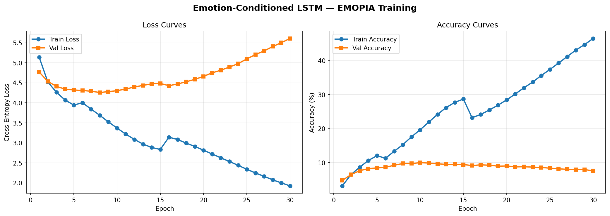

# EMOPIA Studio: Emotion-Conditioned AI Music Generator 🎹✨

An end-to-end deep learning music composition system that generates pop piano music conditioned on specific emotional moods based on **Russell's Valence-Arousal circumplex model**.

Powered by a 2-layer stacked **PyTorch LSTM** trained on the **EMOPIA Dataset (ISMIR 2021)**, with physical acoustic piano modeling, real-time MP3/WAV/MIDI synthesis, and a minimal, sleek light-themed web studio.



---

## 🌟 Key Features

* **4 Emotion Quadrants**:
  * **Q1 (Happy / Excited)**: High Valence, High Arousal (fast tempo, bright melodies, upbeat rhythm)
  * **Q2 (Angry / Tense)**: Low Valence, High Arousal (turbulent, sharp dissonance, rapid driving cadence)
  * **Q3 (Sad / Depressed)**: Low Valence, Low Arousal (melancholic minor keys, lingering notes)
  * **Q4 (Calm / Relaxed)**: High Valence, Low Arousal (gentle pacing, soothing consonant chords)
* **Direct Audio Synthesis (MP3 & WAV)**:
  * Generates **MP3** (192 kbps studio audio via LAME), **WAV** (44.1 kHz uncompressed PCM), and **MIDI** (.mid).
  * Synthesizes piano physical acoustics with harmonic overtones ($f_0$ through $6f_0$) and natural percussive hammer decay.
* **Music Theory & Composition Metrics**:
  * Real-time calculation of **Note Density (notes/s)**, **Pitch Range & Span**, **Dominant Key Signature** (Krumhansl-Schmuckler profile), and **Duration**.
* **Modern Minimal Light Theme Web App**:
  * Built with FastAPI + vanilla HTML/CSS/JS.
  * Interactive audio player with custom animated waveform visualizer, playhead scrubbing, and instant downloads.
* **GPU Accelerated (CUDA)**:
  * Autoregressive next-token sampling with temperature control in ~1.5–3.5s per song.

---

## 🏗️ Architecture

```
                      Emotion Quadrant (0–3)
                                │
                      Embedding(4, 32)
                                │
Token Sequence ──► Embedding(vocab, 128)
                                │
                          Concatenate (160)
                                │
                      LSTM Layer 1 (hidden=512)
                                │
                          Dropout (0.3)
                                │
                      LSTM Layer 2 (hidden=256)
                                │
                          Dropout (0.3)
                                │
                      Linear(256, vocab_size)
                                │
                        Cross-Entropy Loss
```

### Tokenization Strategy
Each musical note is parsed with `pretty_midi` and encoded as:
$$\text{Token} = \text{pitch} \times \text{NUM\_DUR\_BUCKETS} + \text{dur\_bucket} + 1$$
Where duration is binned using inter-onset intervals (IOI) across 11 discrete buckets.

---

## 🚀 Quick Start

### 1. Installation
Clone the repository and install requirements:
```bash
git clone https://github.com/Atharva-Gadi/emopia-emotion-music.git
cd emopia-emotion-music
pip install -r requirements.txt
```

*(For NVIDIA GPU acceleration, ensure CUDA PyTorch is installed: `pip install torch --index-url https://download.pytorch.org/whl/cu126`)*

### 2. Launch the Web Studio
Start the local server:
```bash
uvicorn app:app --host 127.0.0.1 --port 8000
```
Open **[http://127.0.0.1:8000](http://127.0.0.1:8000)** in your browser.

### 3. CLI Music Generation
Generate music directly from the command line:
```bash
# Generate a Happy piece (Q1):
python generate_music.py --emotion 1

# Generate a Sad piece with higher creativity:
python generate_music.py --emotion 3 --temperature 1.0 --length 350

# Generate all 4 emotions in one command:
python generate_music.py --all

# Convert any existing MIDI file to MP3 & WAV:
python generate_music.py --convert "my_song.mid"
```

---

## 📊 Training Results (30 Epochs on RTX 3050)

* **Dataset**: EMOPIA v1.0 (1,078 pop piano MIDI clips)
* **Training Loss**: Dropped from **5.14** to **1.92**
* **Training Accuracy**: Climbed to **46.5%**
* **Best Validation Loss**: **4.2589** (Epoch 8 checkpoint preserved in `best_emotion_lstm.pt`)

---

## 📁 Repository Structure

```
emopia-emotion-music/
├── app.py                      # FastAPI web server and API endpoints
├── generate_music.py           # Standalone CLI music generator and audio converter
├── emopia_emotion_lstm.py      # Complete training pipeline script
├── emopia_emotion_lstm.ipynb   # Interactive Jupyter notebook
├── best_emotion_lstm.pt        # Trained PyTorch model checkpoint (Epoch 8)
├── training_curves_emopia.png  # Loss & accuracy curves plot
├── requirements.txt            # Python dependencies
├── static/
│   ├── index.html              # Sleek minimal light theme UI
│   ├── style.css               # Design system & responsive styles
│   ├── app.js                  # Audio player, visualizer, & API integration
│   └── generated/              # Sample generated MP3, WAV, and MIDI pieces
```

---

## 📜 Citation & Credits
* **EMOPIA Dataset**: Hung et al., *"EMOPIA: A Multi-Modal Pop Piano Dataset For Emotion Recognition and Emotion-based Music Generation"*, ISMIR 2021.
